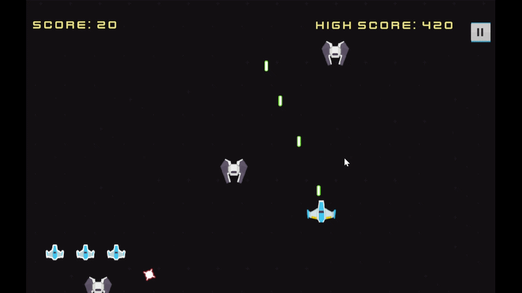

# The Coulus

## About

The Coulus is a 2D pixel-art arcade shooter built as a university assignment.
Pilot a spaceship, gun down waves of enemies, and survive long enough to face the boss —
a laser-firing enemy that appears after clearing a set number of kills.

 

<table>
  <tr>
    <td>
      
    </td>
    <td valign="top">

**Platform:** WebGL (Browser)  
**Engine:** Unity  
**Language:** C#  

 

  </td>
  </tr>
</table>

---

## Gameplay

Fly your spaceship and shoot down enemies before they reach you.
Survive each wave, collect heart pickups to stay alive, and take down the boss when it appears.

## Controls

| Input | Action |
|---|---|
| `W` `A` `S` `D` | Move |
| `Space` / `Enter` | Shoot |

## Key Features

- **Wave-based Enemy Spawning** — enemies spawn continuously with increasing pressure over time
- **Boss Encounter** — a boss appears after reaching a kill milestone, attacking with a laser
- **HP & Life System** — take damage from collisions and enemy fire
- **Heart Pickup** — collect hearts dropped in-game to restore health
- **Persistent High Score** — best score saved locally across sessions
- **Full Audio** — background music and sound effects throughout gameplay
- **Pause & Resume** — pause at any point during a run

## Personal Contribution

Solo developer on this project — handled everything end to end:
- **Game Design** — designed core loop, enemy behavior, and boss encounter trigger
- **Programming** — built all gameplay systems from scratch in Unity with C#
- **Balancing** — tuned enemy spawn rate and boss trigger threshold for pacing
- **Art** — used free assets from [Kenney](https://kenney.nl); no original art created

## Code Architecture

- **Singleton pattern** via `GameManager` and `AudioManager` for global state, score tracking, and audio persistence across scenes
- **`DontDestroyOnLoad`** to persist managers through scene transitions
- **`PlayerPrefs`** for local high score persistence
- **Enemy AI** with configurable spawn patterns and kill-count-based boss trigger logic
- **Boss behavior** implemented as a separate state — fires laser projectiles on a timed interval
- **`Rigidbody2D.linearVelocity`** for physics-based movement to ensure reliable collision detection
- **Heart pickup** system using trigger colliders for health restoration

## Development Duration

~2–3 weeks — solo, from initial setup to WebGL deployment on itch.io

## Notes

- Best played on desktop via Google Chrome or Microsoft Edge.
- Found a bug? Feel free to open an issue.

## Author

Made by [Natnat](https://github.com/nataalyly)
